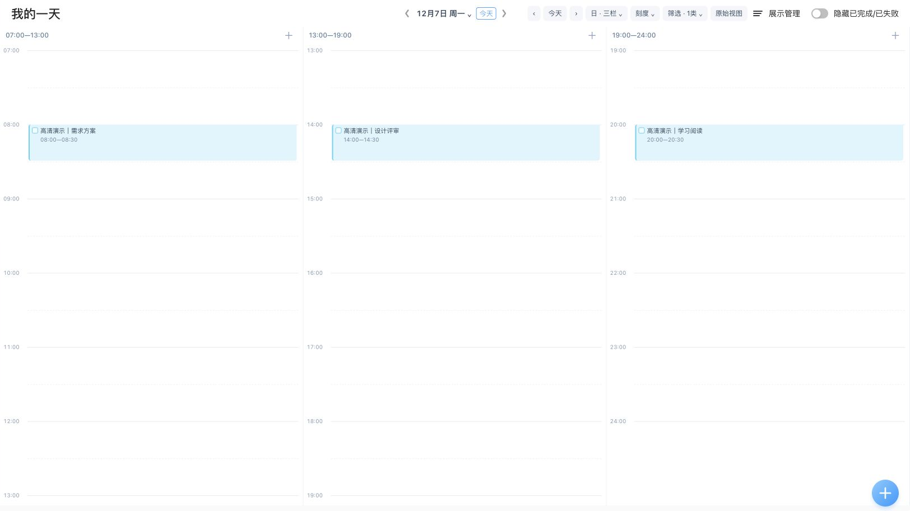
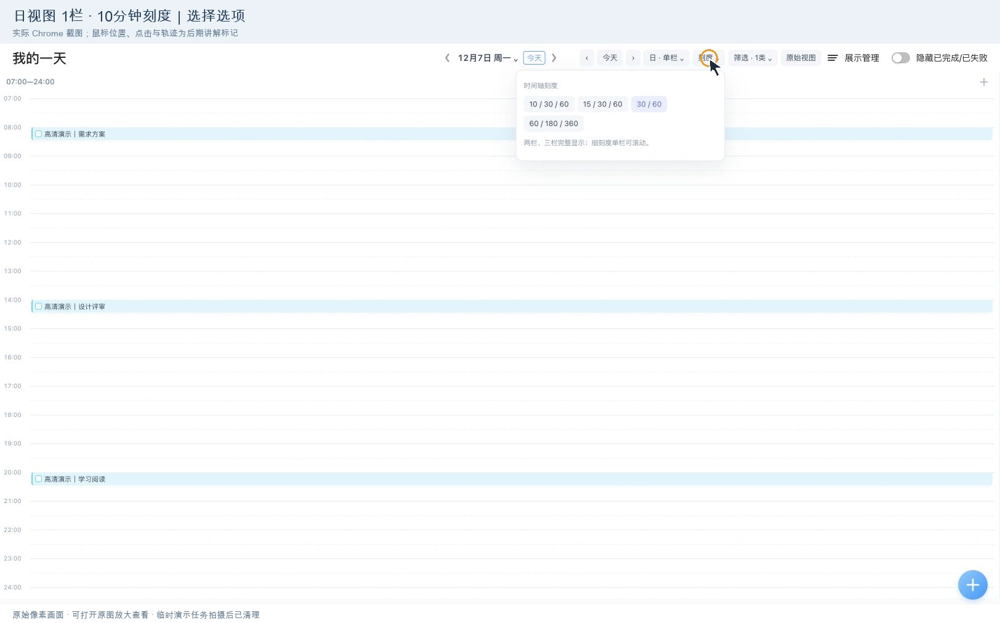
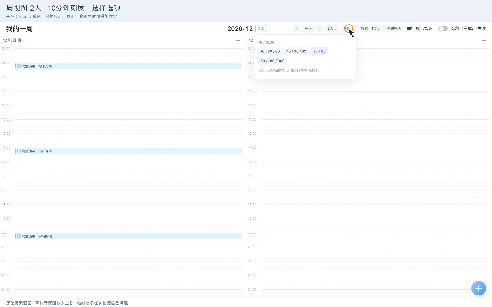
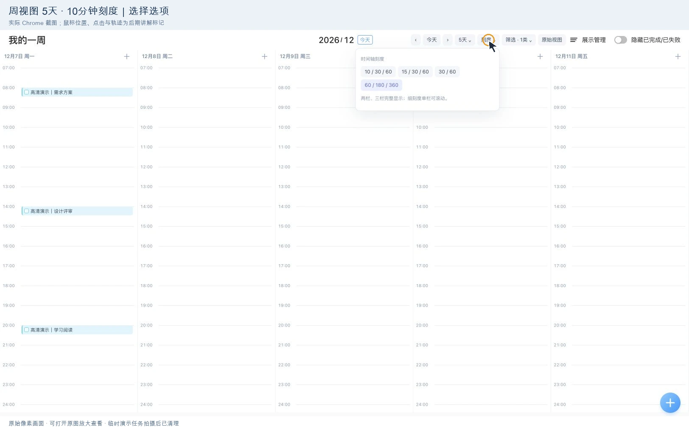
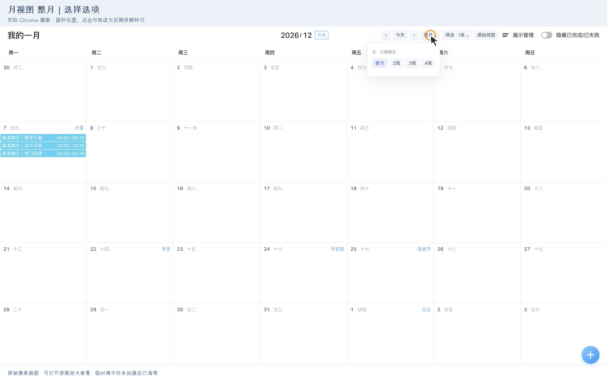
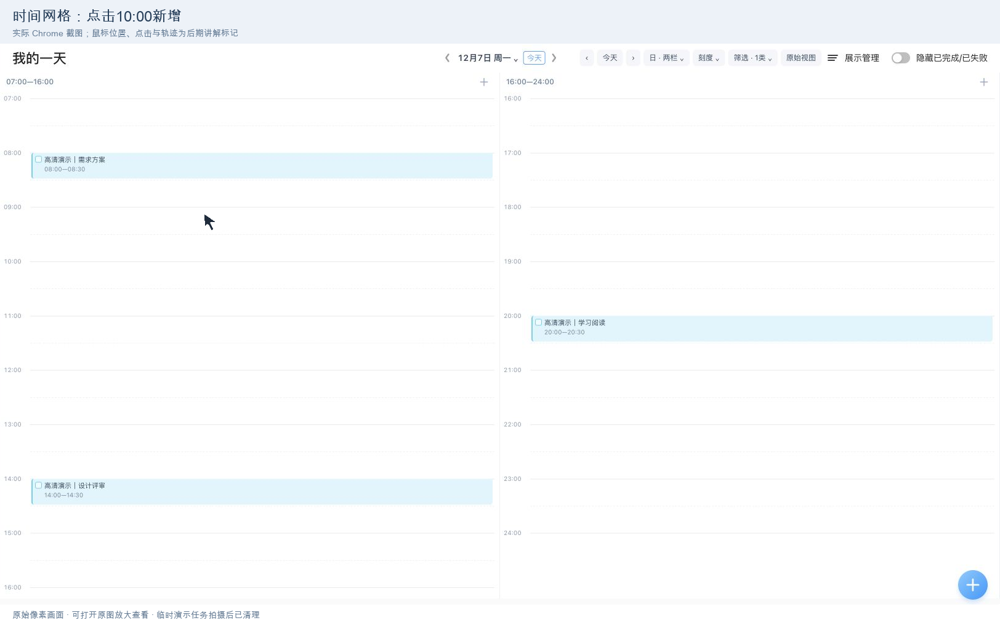

# 时光序增强版·融合滴答清单

为时光序网页版增加日、周、月视图与清单布局。通过页面原生事项和表单操作，保留提醒、重复、子任务、备注等原有字段。

**当前版本：0.6.6** · 非官方项目 · 仅适用于桌面网页版

[安装与更新（Greasy Fork）](https://greasyfork.org/zh-CN/scripts/602232) · [查看脚本源码](shiguangxu-enhanced_0.6.6_261029_1041.user.js) · [时光序网页版](https://web.shiguangxu.com/)



## 安装

1. 在浏览器中安装 Tampermonkey 等用户脚本管理器。
2. 打开上方 Greasy Fork 页面，点击安装，完成脚本管理器的安装确认。
3. 刷新已登录的时光序网页版。已有同名旧脚本时，更新原脚本，避免重复启用。

推荐通过 Greasy Fork 安装并接收更新。GitHub 提供对应版本源码和说明；下载 `.user.js` 后也可导入脚本管理器。此仓库不是独立日程应用，直接打开脚本文件不会运行界面。安装脚本仍需要浏览器中的确认操作。

## 功能

| 视图 | 可选范围 | 组合数 |
| --- | --- | --- |
| 日视图 | 单栏、两栏、三栏 × 10、15、30、60 分钟最小刻度 | 12 |
| 周视图 | 2、3、5、7 天 × 四种最小刻度 | 16 |
| 月视图 | 整月、2 周、3 周、4 周 | 4 |

- 单天两栏、三栏按可用页面高度展示；细刻度的单栏及多日视图可纵向滚动。
- 普通点击任务调用完整原生详情；空白处新增按所选日期和网格时刻预填，弹窗贴近点击位置，靠边自动避让。
- 拖动任务上下边缘时显示跟手预览、红色新时间和灰色原时间。右下角取消或确认，确认才通过原生表单保存；取消恢复。
- 悬停一秒显示两行内容和时间提示，不放大任务卡片。
- 日程采用按日期排列的时间线；全部、清单、重复改为左侧切换、右侧原生清单。
- 筛选只影响显示；原始视图可切回。备忘录、日记、番茄专注仅调整显示样式。
- 原生弹窗保留结构和字段，仅微调线条、字体、颜色。

## 全部组合与鼠标轨迹演示

点击图片可查看原尺寸。以下是实际 Chrome 截图步骤组成的讲解动画，鼠标轨迹及点击圈按实际坐标后期标注，**不是连续录屏**。应用画面保留原像素尺寸，发布版采用 WebP 压缩。

### 日视图 · 全部 12 种



### 周视图 · 2 天、3 天，共 8 种



### 周视图 · 5 天、7 天，共 8 种



### 月视图 · 全部 4 种



### 点击处新增、拖动预览与取消



## 工作方式与数据

脚本为单文件原生 JavaScript，无构建步骤、无外部代码依赖，运行范围为 `https://web.shiguangxu.com/home/*`。需要浏览器、脚本管理器、时光序账号和正常网络连接。

脚本读取原生页面节点生成增强视图，任务点击、完成、新增和保存仍通过原生页面操作。脚本不请求自己的网络接口，不另存任务记录；仅将视图偏好保存在浏览器本地。原站自身的联网和数据同步仍由时光序处理。原站 DOM 或样式变化可能影响兼容性。

## 本地检查

安装 Node.js 后，在仓库目录运行：

```sh
node --check shiguangxu-enhanced_0.6.6_261029_1041.user.js
node regression_0.6.6_261029_1041.cjs
```

回归文件使用本地模拟 DOM，覆盖原生点击转发、网格时刻预填、拖动预览与取消、确认保存和遮罩退出等 29 组检查，不连接账户，不创建真实任务。它不能替代安装后的原站验收。

## 验证边界与已知限制

- 展示素材拍摄于 **0.6.5**，32 种组合已在原站切换并记录；仅使用临时演示任务，拍摄后已清理。
- **0.6.6** 增加了保存结束时独立遮罩退出修复；对应代码回归检查已通过，更新安装后的原站复验仍待完成。本次 GitHub 发布不等于新增了完整实机验收。
- 跨午夜、跨分栏边界及重复任务系列保存尚未完整验收。这些场景建议打开原生编辑器核对日期、时间和重复范围。
- 本仓库保存当前公开版，未在发布过程中更改业务逻辑或原站数据。

## 文件

- `shiguangxu-enhanced_0.6.6_261029_1041.user.js`：与 Greasy Fork 0.6.6 对应的脚本。
- `regression_0.6.6_261029_1041.cjs`：可独立运行的 29 组本地回归检查。
- `*.png`、`*.webp`：演示任务的界面截图和鼠标轨迹讲解动画。

## 归属与许可

本项目非时光序或滴答清单官方产品，与其运营方无隶属或合作关系。名称用于说明适用平台和界面参考，相关品牌归各自权利人所有。

当前**未声明代码许可证**。公开查看不代表授予修改、再分发或商业使用许可。
